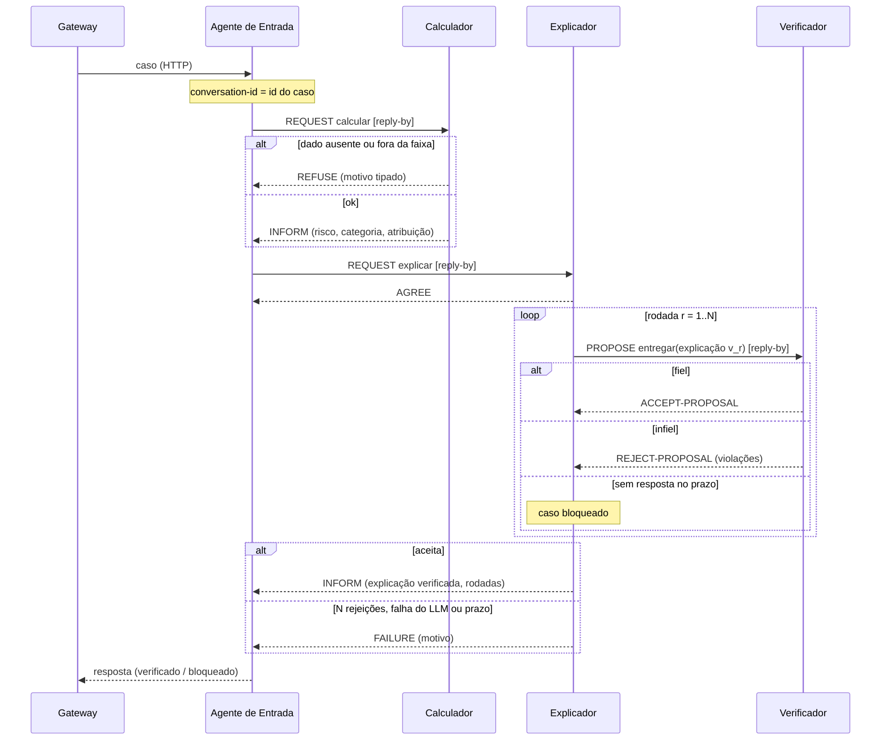

# Por que JADE? O que ele agrega e o que não agrega

> **Revisão de 06/10/2026.** A versão anterior tinha dois erros apontados pelo [parecer de SMA](../05-banca/parecer-sma.md) e conferidos por mim nas fontes: atribuía ao FIPA-Propose várias rodadas e um FAILURE final, e dizia que o MAST recomenda protocolos contra falhas de término. As duas afirmações foram retiradas. A decisão vigente é a [D032](../00-projeto/decisoes.md).

## 1. Posição em uma frase
O JADE **não melhora a fidelidade das explicações**. Quem pode melhorá-la é o verificador, que é um módulo Python independente (D034). O JADE dá à conversa entre os componentes uma forma padronizada, com decisão de entrega tipada, prazos e rastro auditável. É uma **propriedade de engenharia**, demonstrada por testes, e não um fator do experimento.

## 2. Estado do código (honestidade)
Em 06/10/2026 nada disto está implementado: os agentes trocam mensagens *ad hoc*, o Classificador chama o modelo antigo e a explicação sai por um canal HTTP lateral. Este documento descreve o **desenho a implementar**, não o sistema atual. O texto do TCC só pode afirmar o que estiver no código na data da entrega.

## 3. O protocolo (corrigido)

### 3.1 Por que não é "um FIPA-Propose com várias rodadas"
O FIPA-Propose tem **uma rodada**: o iniciador envia uma proposta e o participante "responds by either accepting or rejecting the proposal" (SC00036H, §1.1). O padrão não prevê nova proposta na mesma instância nem FAILURE ao final. A API do JADE confirma: `ProposeInitiator` só trata aceite, rejeição, não entendido, fora de sequência e fim das respostas.

### 3.2 Protocolo composto adotado
| Camada | Protocolo FIPA | Papel |
|---|---|---|
| Externa | **FIPA-Request** (SC00026H) | Abre e encerra o caso. É ele que admite AGREE, REFUSE, FAILURE e INFORM |
| Interna, repetida | **FIPA-Propose** (SC00036H), uma instância por rodada | O Explicador propõe "entregar a explicação v_r"; o Verificador aceita ou rejeita com a lista de violações |

- Todas as mensagens de um caso levam o mesmo `conversation-id`, e o número da rodada vai no conteúdo.
- O limite de N rodadas é **política do agente**, não do padrão. Esgotado o limite, o Explicador responde FAILURE ao pedido externo e o caso é **bloqueado**.
- Toda mensagem de iniciação leva `reply-by`. Sem resposta no prazo, o caso é bloqueado: nada é entregue sem ACCEPT-PROPOSAL.
- **Alternativa considerada:** FIPA Iterated Contract Net (SC00030H), que já prevê rodadas e existe no JADE (`ContractNetInitiator.newIteration`). Foi preterida porque seu sentido é a escolha entre vários concorrentes por chamada de propostas; aqui há um único participante e a proposta parte do Explicador.

### 3.3 Por que "propor" e não "informar"
O Verificador conclui uma proposição ("a explicação é fiel ao cálculo"), cujo ato natural em FIPA seria *inform* ou a resposta a um *query-if*. Mantém-se o Propose porque o que está em jogo é uma **ação**: `entregar(explicação v_r)`, com a fidelidade como precondição. *Accept-proposal* significa que o participante quer que o iniciador execute a ação (SC00037J), e *reject-proposal* carrega "a further proposition which denotes the reason for the rejection", que é a lista de violações. A alternativa com FIPA-Query deixaria a decisão de entrega fora do protocolo.

### 3.4 Sequência

## 4. O que o JADE agrega

### 4.1 Decisão de entrega como ato de fala tipado
A decisão do Verificador deixa de ser texto livre e vira ACCEPT ou REJECT, com conteúdo estruturado e legível por máquina. Há um único ponto de saída: a explicação só chega ao Agente de Entrada depois do aceite.

### 4.2 Recusa tipada na entrada
O Calculador responde REFUSE, com motivo, a dado ausente ou fora da faixa, em vez de supor um valor. Suposições sobre valores ausentes foram a principal causa de erro em notas reais no AgentMD ([jin2025agentmd](../01-literatura/fichamentos/jin2025agentmd.md) [C4]). O gateway já faz essa recusa hoje, fora do JADE; o protocolo a formaliza.

### 4.3 Rastro auditável
Cada mensagem ACL registra performativa, emissor, receptor, `conversation-id`, rodada e conteúdo. Gravadas em JSON Lines, dão por caso: rodadas até o aceite, violações por tipo, bloqueios e tempos. O *Sniffer* do JADE mostra a conversa de um caso na defesa.

### 4.4 Tratamento de falha previsto no protocolo
Prazo de resposta, mensagem não entendida e mensagem fora de sequência têm tratadores prontos nos comportamentos de protocolo do JADE.

## 5. O que o JADE não agrega
- **Fidelidade.** Depende da qualidade do verificador, não do protocolo.
- **Prevenção de falhas de término e repetição.** Aqui elas são evitadas porque o laço é controlado por código, com limite N. **Um `for` em Python faz o mesmo.**
- **O que o MAST de fato diz** ([cemri2025mast](../01-literatura/fichamentos/cemri2025mast.md)): associa "standardized communication protocols" à categoria de desalinhamento entre agentes e alerta que "solutions focused on context or communication protocols are often insufficient" (Insight 2). Observa ainda que os erros dessa categoria ocorrem mesmo entre agentes do mesmo arcabouço. Os percentuais de falha do MAST vêm de sistemas de programação e matemática e não se transferem a este domínio. **O MAST não é usado como justificativa do JADE.** Ele fundamenta o verificador em mais de um nível (Insight 3).
- **Autonomia.** O Verificador de nível 1 é uma função determinística: ele **detém a decisão de entrega**, mas não tem objetivos próprios. Dos atributos de Wooldridge & Jennings, o sistema exibe reatividade e, depois de implementada a ACL com protocolos, habilidade social. Autonomia e proatividade são fracas em todos os agentes. O enquadramento é **arquitetura orientada a agentes com interação protocolada**, não sistema multiagente autônomo.
- **Controle experimental.** O experimento roda em Python, com as três configurações no mesmo executor (D032). A afirmação anterior de "ablação por composição de agentes" foi retirada: C-isolado usa outro prompt, e rodar uma configuração em Python e outra em JADE introduziria diferenças além do verificador.

## 6. Custos e riscos
- Ponte Java ↔ Python por HTTP.
- JADE 4.6.0 é de 2022, não está no Maven Central, e o repositório oficial apresenta cadeia TLS incompleta ([anexo 06 do parecer](../05-banca/anexos/sma/06-infra-externa.txt)). Mitigação: versionar o jar (a licença LGPL permite) e fixar o JDK 17.
- O domínio fipa.org deixou de servir as especificações. As citações usam as cópias do Internet Archive, com data de acesso.

## 7. Respostas prováveis à banca
- **"Um laço em Python não faria o mesmo?"** Faria o controle do laço. Não traria a semântica padronizada dos atos de fala, os prazos e o `conversation-id` prontos nem a ferramenta de inspeção. O ganho é de forma e de auditabilidade, não de capacidade.
- **"Por que não A2A?"** O A2A 1.0 também tem estados terminais de tarefa (`completed`, `failed`, `canceled`, `rejected`) e agrupa interações por `contextId`. A diferença defensável é outra: a FIPA tem atos de aceitar e rejeitar **uma proposta** com semântica formal e protocolos de negociação prontos; no A2A, isso ficaria como convenção no conteúdo. Migrar é trabalho futuro plausível.
- **"Por que não MCP, LangGraph ou AutoGen?"** O MCP liga agentes a ferramentas, não coordena agentes; o Calculador poderia ser exposto por MCP sem mudar a tese. LangGraph e AutoGen implementam o mesmo laço avaliador-otimizador com condição de parada, sem atos de fala padronizados.
- **"Isso é multiagente de verdade?"** É uma arquitetura orientada a agentes. A interação Explicador–Verificador é protocolada; o restante é um fluxo com responsabilidades separadas.
- **"O experimento passa pelos agentes?"** Não. O experimento roda nos módulos Python que os agentes também usam. Um teste de equivalência mostra que, para o mesmo texto e o mesmo caso, o Verificador decide igual nos dois caminhos.

## 8. Posicionamento na literatura
- **Botti (2025, *preprint*)** defende incorporar padrões de plataformas e de linguagens de comunicação de SMA aos agentes com LLM ([botti2025reinventing](../01-literatura/fichamentos/botti2025reinventing.md)). O TCC está **em linha com essa posição**, em uma instância modesta (um ciclo de duas partes).
- **Petrova et al. (2025)** descrevem a passagem da semântica "na plataforma" para a semântica "no modelo" ([petrova2025webofagents](../01-literatura/fichamentos/petrova2025webofagents.md)). Aqui a semântica da interação fica no protocolo, e a do conteúdo, no LLM.

## 9. Consequências no código (D032)
1. Serviço Python fino que expõe cálculo, geração e verificação (os mesmos módulos do experimento).
2. Calculador: `AchieveREResponder`, com REFUSE e FAILURE.
3. Explicador: responde ao REQUEST externo e inicia um `ProposeInitiator` por rodada.
4. Verificador: `ProposeResponder`.
5. `conversation-id` do caso e `reply-by` em todas as mensagens.
6. Registro em JSON Lines de toda mensagem enviada e recebida.
7. Teste de ponta a ponta: aceite na 1ª rodada, rejeição seguida de aceite, bloqueio após N rodadas, recusa na entrada e prazo estourado.

## 10. Fontes e profundidade de leitura
- **Conferidas no texto:** FIPA SC00036H, SC00026H, SC00030H e SC00037J (cópias do Internet Archive, em `05-banca/anexos/sma/`); MAST, Insight 2, Insight 3 e Apêndice G (`textos/cemri2025mast.txt`); AgentMD.
- **Conferida por terceiro (parecer de SMA), não por mim:** API do JADE 4.6.0 por `javap`; estados do A2A 1.0.
- **Lidas só pelo resumo:** Botti 2025, Petrova 2025, Ehtesham 2025, Wooldridge & Jennings 1995, Jennings 2000. São usadas como posicionamento, não como evidência. Ler na íntegra antes da defesa, com prioridade para Wooldridge & Jennings.
- **A acrescentar:** Bellifemine, Caire & Greenwood (2007), referência canônica do JADE.
