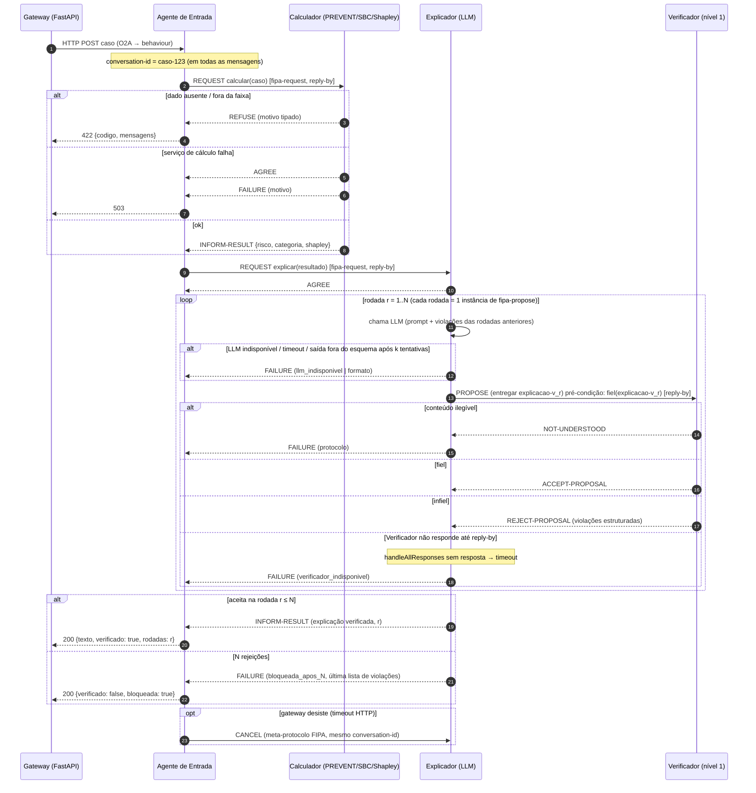

# Parecer da banca: sistemas multiagentes

**Avaliador(a):** Prof.(a) Dr.(a) em Sistemas Multiagentes (JADE, FIPA-ACL, AOSE, agentes com LLM)
**Objeto:** `tcc/02-argumentacao/justificativa-jade.md`, decisões D006, D007, D019, D021 e D025, `escopo-e-arquitetura.md`, `proposta.md` §8, os fichamentos de SMA e o código em `jade-agents/`, `backend-gateway/app/main.py` e `backend-gateway/app/avaliacao.py`.
**Data da inspeção:** 29/09/2026 (árvore de trabalho com alterações não commitadas; ver `git status`).
**Evidências brutas:** `tcc/05-banca/anexos/sma/` (compilação, testes de fumaça, `javap` da API JADE, especificações FIPA arquivadas, conferência do MAST).

---

## 1. Parecer resumido e veredito

O texto argumentativo sobre o JADE amadureceu. A justificativa D021 é bem mais honesta que a anterior ("o código já existia"), reconhece limites (§4 da justificativa) e escolhe um uso concreto de FIPA: o protocolo Propose no ciclo Explicador ↔ Verificador. O enquadramento "arquitetura orientada a agentes", sem prometer um "SMA autônomo" (D019), é o correto.

A defesa, porém, ainda se apoia em **código que não existe**, e o que existe contradiz o texto:

1. **Nenhuma das quatro contribuições do JADE está implementada.** Não há `ProposeInitiator`/`ProposeResponder`, `AchieveRE*`, `conversation-id`, `protocol`, `reply-by`, DF nem registro das mensagens ACL. A busca por esses termos em `jade-agents/src` não encontrou nenhuma ocorrência. O "Verificador" (`AgenteJulgador`) só repassa mensagens, e a explicação chega ao usuário por um **canal HTTP lateral** (`AgenteExplicador.java:55-56, 214-250`), fora da ACL. Assim, mesmo depois de implementado, o Verificador não controlaria o que é entregue.
2. **O pipeline JADE ainda está ligado ao modelo descartado.** O `AgenteClassificador` chama o XGBoost/`cardio_train` (`AgenteClassificador.java:23`), que D016 tirou do núcleo. O PREVENT, o motor SBC e o Shapley existem apenas em Python (`experimentos/piloto`), e tanto o piloto quanto a nova interface rodam **sem JADE** (D025; `avaliacao.py:4-7`; `rodar_piloto.py:2`).
3. **Parte da fundamentação técnica está incorreta ou esticada.** O FIPA-Propose (SC00036H) é um protocolo de **uma rodada**: não prevê nova PROPOSE "na mesma conversa" nem FAILURE ao final. O MAST mapeia "protocolos padronizados" para a categoria FC2, e não para término, repetição, histórico ou verificação. O próprio MAST afirma (Insight 2) que soluções centradas em protocolo "são frequentemente insuficientes". Por fim, as referências de posicionamento (Botti, Petrova, Ehtesham, Wooldridge & Jennings, Jennings) foram **lidas apenas pelo resumo**, como declara a própria justificativa (linha 77).

**Veredito para a parte de SMA: revisão maior.** Hoje a parte de agentes **não se sustenta numa defesa**: a banca abriria o repositório e encontraria uma cadeia de serviços que não segue nenhum protocolo FIPA. O desenho proposto é defensável e viável para um TCC, desde que (a) o protocolo seja implementado e testado, (b) o fluxo experimental C-verificador passe de fato pelos agentes, (c) as alegações sobre FIPA e MAST sejam corrigidas como indicado nas seções 4 e 7. Há ainda uma alternativa legítima, que a banca também aceitaria: remover o JADE e declarar um *workflow* avaliador-otimizador em Python. O que não é aceitável é defender o JADE com base em código futuro.

---

## 2. Notas por critério (0–10)

| Critério | Nota | Justificativa |
|---|---:|---|
| Adequação do conceito de agente | **5** | O enquadramento de D019 e de `escopo-e-arquitetura.md` §3 é honesto: fala em *workflow* e em "arquitetura orientada a agentes". Mas o título da proposta (`proposta.md:13`, "arquitetura multiagente híbrida") e o `pom.xml:18` ("agentes autônomos") dizem outra coisa. A justificativa (§3, linha 56) atribui "autonomia" ao Verificador, que é uma função determinística (nível 1, D020) sem objetivos próprios. Pelo critério de Wooldridge & Jennings, isso é controle local de decisão, não autonomia no sentido forte. |
| Justificativa do JADE (D021) | **5** | O documento é estruturado e declara custos e o que o JADE não agrega. Três dos quatro argumentos, porém, valem para qualquer implementação com máquina de estados e log (a própria justificativa admite isso para a ablação, linha 51). O argumento MAST está mal mapeado (§4.3), e as fontes de posicionamento foram lidas só pelo resumo. |
| Adequação do protocolo | **5** | O Propose é **semanticamente defensável** se a ação proposta for "entregar a explicação X ao usuário" (SC00037J: *propose* = proposta de o **emissor** executar uma ação). Não cobre a iteração nem o FAILURE descritos na tabela da justificativa (linhas 22-24). Faltam timeouts, NOT-UNDERSTOOD, falha do LLM e indisponibilidade do Verificador (§7). Há alternativas FIPA que cobrem melhor a iteração (Iterated Contract Net, SC00030H) e o julgamento epistêmico (Query-If/Request). |
| Qualidade do código atual | **3** | Compila com JDK 17 (anexo 01), mas: nenhum protocolo; HTTP bloqueante dentro de `CyclicBehaviour`; REQUEST sem resposta (o participante silencia, anexo 02); NPE quando o JSON vem incompleto (anexo 03); `send()` chamado de thread HTTP; `reply-with` baseado em relógio; comportamento de espera sem timeout; formatação dependente de `Locale` (anexo 05); nome do paciente enviado ao LLM; nenhum teste; `pom.xml:176` aponta para uma classe inexistente. |
| Coerência texto × código | **2** | O texto descreve protocolo, `conversation-id`, REFUSE, log ACL, Verificador e configurações por agentes ativos, e nada disso existe. O Calculador descrito (PREVENT) não é o que o agente chama (XGBoost). A explicação sai por HTTP lateral. A interface e o piloto não usam JADE. `escopo-e-arquitetura.md:23` ainda descreve o gateway fazendo *polling* do JADE como fluxo vigente. |
| Posicionamento frente a A2A/MCP | **4** | A distinção MCP (ferramentas) × A2A (agentes) está certa. Mas a resposta "A2A não tem término definido" ignora que o A2A 1.0 tem máquina de estados de tarefa com estados terminais `completed/failed/canceled/rejected`, o estado `input-required` e o agrupamento por `contextId`. O MAST, citado pelo próprio projeto, diz que padronizar formato (MCP/A2A) não resolve FC2, e isso vale igualmente para a FIPA-ACL. LangGraph e AutoGen não são discutidos. |

**Média simples: 4,0/10** na parte de SMA. Essa média reflete o estado atual. O **desenho** proposto, uma vez implementado conforme §7, pode chegar a 7–8.

---

## 3. Pontos fortes

1. **Honestidade de enquadramento.** D019 e `escopo-e-arquitetura.md` §3 reconhecem que o sistema é um *workflow* sequencial e que o único ponto com interação iterativa é o par Explicador–Verificador, que corresponde ao padrão avaliador-otimizador. É o diagnóstico correto e raro em TCCs.
2. **A justificativa declara limites** ("o JADE não melhora a fidelidade por si", §4; "isso também pode ser feito sem JADE", §2.4). Isso protege o aluno.
3. **Escolha de um protocolo FIPA com semântica pertinente.** Tratar a decisão do verificador como ato de fala tipado (aceita/rejeita, com razão estruturada) é uma boa ideia de pesquisa. A razão estruturada casa com o conteúdo de *reject-proposal*, que inclui "a further proposition which denotes the reason for the rejection" (SC00037J, anexo `fipa-SC00037J-trechos.txt`).
4. **Recusa tipada na entrada** já existe, embora fora do JADE: `avaliacao.py:52-84` recusa com código (`fora_do_escopo`, `dado_ausente`, `fora_da_faixa`) em vez de supor valores. É exatamente o comportamento que o REFUSE do FIPA-Request deveria formalizar.
5. **Limpeza já feita.** Notificador, MQTT e a lógica arbitrária do Julgador foram removidos (D019; diff de `AgenteJulgador.java`), e o modelo do Gemini deixou de ser fixo no código (`GeminiClient.java:22-27`).
6. **Uso do MAST é, em geral, preciso nos números.** Todos os percentuais citados conferem com o texto v3 (anexo 07). O problema está no mapeamento causal, não nos números.
7. **Decisão D007 (agentes por função, não por persona)** bem fundamentada no MedAgentBoard (Apêndice H.4).

---

## 4. Problemas encontrados

### 4.1 Críticos

**C1. As quatro contribuições do JADE (D021) não existem no código, e a defesa depende delas.**
- *Evidência:* `grep -rnE "ConversationId|setProtocol|ReplyBy|DFService|jade.proto|NOT_UNDERSTOOD|REFUSE" jade-agents/src` não retorna nada. As mensagens usam `ACLMessage.REQUEST/INFORM` *ad hoc* com filtros por remetente fixo (`AgenteClassificador.java:42-45`; `AgenteJulgador.java:30-33`). O Julgador é um repassador (`AgenteJulgador.java:13-16`, "apenas encaminha").
- *Por que é crítico:* o texto da justificativa (§6) é uma lista de tarefas, não uma descrição do sistema. Na defesa, "por que JADE?" será respondido com algo que não pode ser demonstrado. O Sniffer mostraria hoje quatro mensagens sem protocolo.
- *Recomendação:* implementar D021 **antes** do experimento C-verificador. No mínimo: (i) `ProposeInitiator`/`ProposeResponder` com `conversation-id` = id do caso e contador de rodada; (ii) `AchieveREResponder` no Calculador com REFUSE/FAILURE; (iii) *logger* de ACL em JSON Lines; (iv) teste automatizado de ponta a ponta. Se o cronograma não permitir, retirar o JADE da tese (ver C3).

**C2. A explicação chega ao usuário por um canal HTTP lateral, fora da ACL e fora do Verificador.**
- *Evidência:* `AgenteExplicador.java:55-56` chama `enviarExplicacaoParaBackend` **antes** de responder ao solicitante (`:59-62`) e posta direto em `POST /explanation/{user_id}` do gateway (`main.py:232-246`). A resposta ACL ao Julgador só é impressa (`AgenteJulgador.java:72-74`). Teste de fumaça (anexo 03): quando o Explicador falha, o Julgador recebe FAILURE e só registra no log. O gateway não é avisado e espera 60 s até devolver 408 (`main.py:185-223`).
- *Por que é crítico:* na arquitetura proposta, o Verificador é um **portão**: nada é entregue sem ACCEPT-PROPOSAL. Com o canal lateral, a explicação sai antes de qualquer verificação. Isso anula H2 se o C-verificador for executado nessa topologia.
- *Recomendação:* um único ponto de saída. Ou o Explicador só entrega após ACCEPT (coerente com SC00036H: aceita a proposta, o *Initiator* executa a ação e devolve o status), ou um agente de fronteira (Entrada/Gateway) recebe o INFORM final do fluxo. Correlacionar pelo `conversation-id`, não por `user_id`.

**C3. O caminho experimental não passa pelo JADE, o que quebra o argumento de ablação por composição.**
- *Evidência:* `rodar_piloto.py:2` executa C-ferramenta em Python puro. `avaliacao.py:4-7` e D025 fazem a interface chamar o LLM direto. O prompt vigente está em `experimentos/piloto/prompt.py`, enquanto o prompt do agente Java (`AgenteExplicador.java:136-212`) é outro: pede JSON de fatores com IMC e marca `bmi > 25` como "alerta" (`:171`), exatamente a armadilha "variável fora do modelo" que H2 quer medir. O `AgenteClassificador` chama o XGBoost (`:23`, `/predict_risk` na porta 8002), não o PREVENT.
- *Por que é crítico:* a justificativa §2.4 afirma que "o código de cada agente é idêntico entre as configurações". Se C-ferramenta roda em Python e C-verificador em JADE, as configurações diferem em prompt, cliente HTTP, parâmetros e parsing, não "só pela presença do Verificador". Isso é uma ameaça direta à validade interna de H2. Além disso, o C-isolado da proposta (§9.1: "LLM calcula o risco sozinho") exige **outro prompt**, então o Explicador também não é idêntico nesse caso.
- *Recomendação:* um único executor para as três configurações. Opção A: todos os casos passam pelo JADE, e o agente Explicador chama o **mesmo** `prompt.py`/`llm.py`, por exemplo via um serviço Python fino. Opção B: tudo em Python, e o JADE sai. Registrar no método qual opção foi adotada e declarar a diferença de prompt do C-isolado.

### 4.2 Maiores

**M1. O FIPA-Propose não especifica iteração nem FAILURE, e a tabela da justificativa atribui ao padrão algo que ele não tem.**
- *Evidência:* SC00036H §1.1 (anexo `fipa-SC00036H-propose.txt`): "The Initiator sends a propose message [...] The Participant responds by either accepting or rejecting [...] Completion of this IP with an accept-proposal act would typically be followed by the performance by the Initiator of the proposed action and then the return of a status response." Não há laço nem FAILURE no protocolo. A justificativa, linhas 23-24, diz "Nova PROPOSE na **mesma conversa**" e "Após N rejeições: **FAILURE**". A API JADE confirma: `ProposeInitiator` tem apenas `handleAcceptProposal/RejectProposal/NotUnderstood/OutOfSequence/AllResponses`, sem fase de resultado. Já `ContractNetInitiator` tem `newIteration(Vector)` (anexo 04).
- *Recomendação:* descrever o ciclo como **protocolo composto** ("N instâncias de FIPA-Propose encadeadas sob um mesmo `conversation-id`, com contador de rodada no conteúdo, dentro de um FIPA-Request externo cujo FAILURE encerra o caso"), ou adotar o **FIPA Iterated Contract Net** (SC00030H) com um único participante. Este último já prevê "issuing a revised cfp" a cada rodada, e o JADE o implementa (`ContractNetInitiator.newIteration`, `SSIteratedContractNetResponder`). Em ambos os casos, desenhar a máquina de estados (ver §7) e dizer explicitamente que o término em N rodadas é **política do agente**, não do padrão.

**M2. O mapeamento MAST → protocolo está incorreto e omite evidência contrária do próprio MAST.**
- *Evidência (anexo 07):* (a) Tabela 4 do MAST: "Standardized communication protocols" aparece na linha de **FC2 (Inter-Agent Misalignment)**. Para FC1 (onde estão término FM-1.5, repetição FM-1.3 e histórico FM-1.4), as estratégias são "Clear role/task definitions [...] Conversation pattern design" e "Comprehensive verification, Confidence quantification". Para FC3, "Comprehensive verification & unit test generation". (b) Insight 2 (linha 339): "Solutions focused on context or communication protocols are often insufficient for FC2 failures". (c) Linhas 346-352: MCP e A2A padronizam o formato, mas "the errors we observe in FC2 occur even when agents within the same framework communicate". (d) "Setting termination conditions" aparece em G.1 como abordagem **tática**, que os autores dizem que "often prove inconsistent". (e) Os percentuais são prevalências em 1.642 *traces* de 7 frameworks de programação e matemática (legenda da Fig. 1) e não se transferem para este domínio.
- *Consequência:* a frase "ataca essas falhas **por construção**" (justificativa, linha 27) não se sustenta. Em particular: FM-1.5 e FM-1.3 ocorrem quando o **LLM** decide quando parar ou repetir. Aqui o laço é controlado por código, e um `for` com limite N em Python evita isso igualmente. FM-1.4 (perda de histórico do LLM) não é resolvida por `conversation-id`, a não ser que o Explicador reinjete as rejeições anteriores no prompt. FM-3.3 (verificação incorreta) depende da qualidade do Verificador, não do protocolo.
- *Recomendação:* reescrever o parágrafo: "o protocolo torna explícitos o término, a rodada e a decisão (auditabilidade); a prevenção de FM-1.3/1.5 decorre do controle determinístico do laço, obtível também sem JADE; o MAST associa protocolos padronizados a FC2 e alerta que são insuficientes sozinhos (Insight 2)". Citar G.1 [55, 62] para "termination conditions".

**M3. O Verificador faz um julgamento epistêmico, mas o Propose expressa intenção sobre uma ação. Isso precisa ser justificado.**
- *Evidência:* SC00037J: *accept-proposal* = "informs the receiver that it intends that [...] the receiving agent will perform the action"; *reject-proposal* = "has no intention that the recipient performs the given action". O que o Verificador conclui é uma **proposição** ("a explicação é fiel ao Shapley"), cujo ato natural em FIPA é *inform*/*disconfirm* ou a resposta a um *query-if*.
- *Recomendação:* manter o Propose é aceitável, desde que o conteúdo da PROPOSE seja explicitamente a **ação** `(entregar explicacao-vK caso-123)` com a precondição `(fiel explicacao-vK)`. O texto deve dizer isso e comparar com a alternativa FIPA-Query (Verificador responde `inform (not (fiel ...))` + violações). A banca vai perguntar.

**M4. As fontes de posicionamento de SMA foram lidas apenas pelo resumo, e uma delas não é revisada por pares.**
- *Evidência:* `justificativa-jade.md:77` ("lidos pelo resumo"). Os fichamentos `wooldridge1995agents`, `jennings2000abse`, `fipa2002propose`, `botti2025reinventing`, `ehtesham2025protocols` e `petrova2025webofagents` têm todos `leitura: resumo`. Botti (2025): em 29/09/2026 o arXiv mostra apenas a v1 (02/06/2025), sem *journal-ref*. Não localizei versão revisada por pares.
- *Recomendação:* ler na íntegra pelo menos Wooldridge & Jennings (seções 1–2), Jennings 2000 (desvantagens da AOSE) e Botti. Citar Botti como preprint. Acrescentar a referência canônica de JADE (Bellifemine, Caire & Greenwood, 2007).

**M5. O Verificador não é "autônomo" no sentido de Wooldridge & Jennings, e o texto afirma que é.**
- *Evidência:* `justificativa-jade.md:56`: "o Verificador tem **autonomia** para aceitar ou rejeitar". No núcleo (D020, `escopo-e-arquitetura.md:55`), o Verificador é "só de nível 1 (determinístico)": uma função pura de (explicação, gabarito). Na noção fraca de W&J, autonomia é operar sem intervenção direta **e ter controle sobre as próprias ações e o estado interno**. Uma função sem estado nem objetivos satisfaz isso só trivialmente.
- *Recomendação:* dizer "o Verificador detém a decisão de entrega (papel de controle)" e reconhecer que **autonomia e proatividade são fracas em todos os agentes**. A habilidade social é o único atributo forte, e só depois de implementada a ACL com protocolos.

**M6. Robustez do código JADE: falhas silenciosas, bloqueio e concorrência.**
- *Evidências:*
  - `AgenteClassificador.java:62-69`: se o serviço falha, só registra no log e **não responde** ao REQUEST. O teste de fumaça (anexo 02) confirma: sem serviço na porta 8002, ninguém é notificado. Pelo FIPA-Request (SC00026H), o participante "must communicate either a failure [...] an inform-done [...] or an inform-result".
  - `AgenteClassificador.java:98` e `GeminiClient.java:104`: chamadas HTTP **bloqueantes** (30 s e 60 s) dentro de `CyclicBehaviour.action()`. Isso trava a thread única do agente e serializa todos os casos. Usar `ThreadedBehaviourFactory` ou chamada assíncrona com `block()`.
  - `AgenteGerenciadorPacientes.java:71, 99`: `send()` executado na thread do `HttpServer`, fora do modelo de *behaviours*. O caminho previsto pelo JADE é O2A (`setEnabledO2ACommunication` / `putO2AObject`). O handler responde **200 para qualquer entrada**, inclusive JSON inválido e GET (anexo 02), e `:77` escreve `getBytes()` no charset padrão depois de declarar o tamanho em UTF-8.
  - `AgenteJulgador.java:55`: `reply-with` = `"explicacao-" + currentTimeMillis()` (colide sob concorrência). `:62-83`: `CyclicBehaviour` de espera **sem timeout**, que fica pendurado para sempre se a resposta não vier.
  - `AgenteExplicador.java:41`: aceita **qualquer** REQUEST de qualquer remetente. `:86-113`: `get(...)` encadeados sem checar nulo, o que dá NPE com JSON incompleto (anexo 03).
  - `main.py:192` registra a espera **depois** de enviar ao JADE (`:141-146`), o que é uma condição de corrida em princípio. `pending_explanations` é indexado por `user_id` (`:23`), então duas requisições do mesmo usuário colidem.
- *Recomendação:* os *behaviours* de protocolo do JADE resolvem boa parte disso por construção (`reply-by` gera timeout em `handleAllResponses`, e o `conversation-id` é gerado ou propagado; anexo 04). Somar a isso a validação por esquema na entrada de cada agente e testes.

**M7. Reprodutibilidade do build JADE.**
- *Evidência:* não há Maven na máquina, e o Java padrão do PATH é 11 (`javac` 1.8), enquanto o projeto exige 17. O JDK 17 existe em `/usr/lib/jvm/java-17-openjdk-amd64` e com ele o código compila (anexo 01). O repositório declarado no `pom.xml:212-217` (`jade.tilab.com/maven`) **não apresenta a cadeia TLS completa** ("unable to verify the first certificate"). O JADE não está no Maven Central (HTTP 404; anexo 06). Não há `docker-compose` (removido). `pom.xml:176` referencia `AgenteHelloWorld`, que não existe. `run-agents.sh:230` roda `mvn clean package` com caminho relativo, e `:253` imprime "iniciada com sucesso" só depois que a JVM termina.
- *Recomendação:* versionar o `jade-4.6.0.jar` (LGPL permite) ou instalá-lo no repositório local via script. Fixar a toolchain (`.java-version`/Dockerfile). Corrigir o `exec-maven-plugin`. Incluir um teste de integração que suba um *container* JADE em processo.

### 4.3 Menores

- **m1. `Locale`.** `AgenteExplicador.java:148` e `:170` usam `String.format` sem `Locale`. Em `pt_BR` (o locale desta máquina), gera `0,42` e `27,5` (anexo 05), enquanto `:163` usa `Locale.ROOT`. No prompt isso mistura separadores decimais, o que é relevante justamente para a métrica de exatidão numérica.
- **m2. Persona médica contra D007.** `AgenteExplicador.java:144`: "Você é um cardiologista experiente", contrariando D007 (agentes por função, não persona).
- **m3. Dado pessoal ao LLM.** `userId`/`patientName` é interpolado no prompt e no JSON sem escape (`AgenteExplicador.java:147, 162`). Isso envolve LGPD e injeção de prompt. A nova interface não faz isso, mas o agente Java faz.
- **m4. Chave de API na URL** (`GeminiClient.java:97`, `?key=`). Prefira o cabeçalho `x-goog-api-key`.
- **m5. Resíduos de nomenclatura.** Pacote `br.com.yourproject`, artefato `cardiac-alert-jade`, descrição "agentes autônomos" (`pom.xml:11-19`). A banca lê isso como código de *template*.
- **m6. Documento desatualizado.** `escopo-e-arquitetura.md:23` ainda descreve o fluxo gateway → JADE com *polling*, e `:44` ainda recomenda justificar o JADE "pragmaticamente: código já existente", o que D021 declarou substituído.
- **m7. Link morto na fonte central.** O fichamento `fipa2002propose.md:8` aponta para `http://www.fipa.org/specs/fipa00036/SC00036H.html`. **O domínio fipa.org hoje serve uma página de cassino norueguês** (anexo 06). Usar a cópia do Internet Archive ou o PDF arquivado, e registrar a data de acesso.
- **m8. Temperatura 0,7** em `GeminiClient.java:69`, `avaliacao.py:132` e no padrão de `rodar_piloto.py:37`. Não é erro, mas precisa ser justificada no método (variabilidade × reprodutibilidade), e o N de repetições deve ser fixado.
- **m9. Nenhum teste Java** (`find jade-agents -path '*test*' -name '*.java'` retorna 0), embora o JUnit esteja no `pom.xml:89-102`.

---

## 5. Perguntas da banca

| # | Pergunta | Resposta esperada (boa) | O projeto responde hoje? |
|---|---|---|---|
| 1 | "Pelo critério de Wooldridge & Jennings, quais dos seus componentes são agentes?" | Todos têm reatividade; a habilidade social vem da ACL com protocolos; autonomia e proatividade são fracas; o Verificador detém a decisão de entrega. Logo, "arquitetura orientada a agentes", não SMA autônomo. | **Parcial.** `escopo-e-arquitetura.md` §3 e D019 respondem bem, mas `justificativa-jade.md:56` superestima a autonomia e o código ainda não tem protocolos. |
| 2 | "Mostre no Sniffer uma conversa completa de um caso com duas rejeições e uma aceitação." | Demonstração com `conversation-id` do caso e as performativas PROPOSE → REJECT → PROPOSE → REJECT → PROPOSE → ACCEPT → INFORM. | **Não.** Nenhum protocolo implementado (C1). |
| 3 | "O FIPA-Propose prevê várias rodadas e FAILURE?" | Não: é uma rodada (SC00036H §1.1). O ciclo é uma composição de Propose sob um FIPA-Request externo, ou um Iterated Contract Net (SC00030H). O limite N é política do agente. | **Não.** A justificativa (linhas 23-24) atribui isso ao padrão (M1). |
| 4 | "Por que *accept-proposal* e não *inform* de um julgamento? O verificador aceita uma ação ou afirma uma proposição?" | A ação proposta é "entregar a explicação vK"; a precondição é a fidelidade. A alternativa Query-If foi considerada e descartada por X. | **Não.** Não discutido (M3). |
| 5 | "O MAST diz que protocolos resolvem término e repetição?" | Não. O MAST associa protocolos padronizados a FC2 e diz que são frequentemente insuficientes (Insight 2). Término e repetição são evitados aqui pelo controle determinístico do laço. | **Não.** A justificativa afirma "por construção" (M2). |
| 6 | "Um laço `for` em Python com limite N e log JSON não faz exatamente o mesmo?" | Faz o controle. O JADE agrega semântica padronizada das mensagens, *timeouts*/`conversation-id` prontos nos *behaviours*, Sniffer e composição declarativa. Não agrega fidelidade. O custo é Java + HTTP. | **Parcial.** `justificativa-jade.md:66` responde, mas só será crível com o código implementado. |
| 7 | "A demonstração de hoje passa pelos agentes? E o experimento?" | O C-verificador passa integralmente pelos agentes. Se C-ferramenta e C-isolado rodam no mesmo executor, a diferença entre configurações é só o Verificador. | **Não.** Interface e piloto são sem JADE (D025; `rodar_piloto.py:2`), e há dois prompts diferentes (C3). |
| 8 | "O que acontece se o LLM cair, ou o Verificador não responder, no meio de um caso?" | O Explicador envia FAILURE (motivo `llm_indisponivel`) ao solicitante. O *reply-by* expira e dispara `handleAllResponses` sem resposta; o caso é **bloqueado** (nunca entregue sem verificação) e registrado. | **Não.** Hoje o gateway espera 60 s e devolve 408 (anexo 03; `main.py:159-163`). |
| 9 | "Por que não A2A? Ele também tem estados terminais e `rejected`/`input-required`." | O A2A 1.0 tem máquina de estados de **tarefa** e `contextId`, mas não tem atos de aceitação/rejeição de **proposta** com semântica formal. A negociação teria de ser codificada no conteúdo. O MAST alerta que padronizar formato não basta. Migrar para A2A é trabalho futuro plausível. | **Parcial.** `justificativa-jade.md:64` ignora os estados do A2A (§6). |
| 10 | "O Botti (2025) é revisado por pares? Você leu?" | É preprint do arXiv (v1, 06/2025, sem *journal-ref* em 29/09/2026), lido na íntegra; usado como posição, não como evidência. | **Não.** O fichamento está com `leitura: resumo`. |
| 11 | "A ablação por composição é válida para o C-isolado, se lá o LLM calcula o risco?" | Não é "o mesmo código": o C-isolado exige prompt e entrada diferentes. A ablação limpa é C-ferramenta × C-verificador. | **Não.** A justificativa §2.4 afirma código idêntico nas três. |
| 12 | "Por que o `AgenteClassificador` chama o XGBoost se o núcleo é o PREVENT?" | O Calculador foi religado ao serviço PREVENT (mesmo módulo do piloto). O XGBoost é extensão (D016). | **Não.** `AgenteClassificador.java:23` ainda chama o XGBoost. |
| 13 | "Como o rastro ACL vira dado de pesquisa? Qual é o esquema do log e que métrica sai dele?" | JSON Lines com `conversation-id`, rodada, performativa, emissor, receptor, carimbo de tempo e violações. Métricas: rodadas até a aceitação, taxa de bloqueio por tipo de violação, custo. | **Parcial.** As métricas estão listadas (`justificativa-jade.md:37`), mas não há esquema nem código. |
| 14 | "Por que uma plataforma de 2022, sem atualização desde então e com repositório sem TLS íntegro?" | Estabilidade do padrão FIPA. O jar fica versionado no repositório. Risco declarado como limitação. | **Parcial.** A justificativa §4 cita o custo, mas não trata a reprodutibilidade do build (M7). |

---

## 6. Diagrama de sequência proposto e estados não tratados

O diagrama materializa D021 de forma **coerente com as especificações**. Um FIPA-Request externo abre e encerra o caso (é ele que admite FAILURE). O ciclo de verificação é uma sequência de FIPA-Propose (uma rodada cada) sob o **mesmo** `conversation-id`, com `reply-by` em todas as mensagens.

**Estados e erros que hoje não são tratados (nem no código nem no texto):**

| Situação | Onde deveria ser tratada | Estado atual |
|---|---|---|
| Timeout de qualquer resposta | `reply-by` em toda mensagem de iniciação. O `ProposeInitiator` o converte em prazo do `MsgReceiver` (anexo 04) | Ausente. O Julgador espera para sempre (`AgenteJulgador.java:62-83`) e o gateway espera 60 s (`main.py:185`) |
| NOT-UNDERSTOOD (JSON fora do esquema) | Todo participante valida o esquema na entrada. Pela SC00036H §1.2, pode encerrar o protocolo | Ausente. Dá NPE e devolve uma FAILURE genérica (anexo 03) |
| Falha do LLM (HTTP 4xx/5xx, bloqueio de segurança, resposta vazia) | Explicador: novas tentativas limitadas, depois FAILURE tipada | `GeminiClient.java:137-138` **devolve como "explicação"** a string "Não foi possível gerar a explicação. Resposta da API: ...", que seguiria adiante como se fosse texto válido |
| Verificador indisponível | Timeout, e o caso **não é entregue** no C-verificador | Não existe Verificador |
| Mensagem fora de sequência / tardia (chega após o timeout) | `handleOutOfSequence`, com descarte registrado | Ausente. Os templates filtram só por remetente |
| Casos concorrentes | `conversation-id` por caso e *behaviours* por conversa | `user_id` como chave no gateway; `reply-with` por relógio |
| Cancelamento pelo cliente | Meta-protocolo *cancel* (SC00036H §1.2) | Ausente |
| Registro do rastro | Interceptar `send`/`receive` (ou um agente *logger*) e gravar JSON Lines | Só `System.out.println` |
| Estado entre rodadas (anti FM-1.4) | O Explicador guarda as violações por `conversation-id` e as reinjeta no prompt | Não existe |

---

## 7. Alternativas modernas e posicionamento (item 6 da auditoria)

- **A2A 1.0** (especificação oficial): define os estados `submitted`, `working`, `input-required`, `auth-required` e os terminais `completed`, `failed`, `canceled`, `rejected`, além de agrupar interações por `contextId`. Portanto, "término definido" **não** diferencia FIPA de A2A. O diferencial real e defensável é outro: a FIPA tem **atos de fala com semântica formal** (SC00037J) e **protocolos de negociação** prontos (Propose, Contract Net), enquanto o A2A modela ciclo de vida de **tarefa** e deixaria "aceitar/rejeitar uma proposta" como convenção no conteúdo. Recomendo reescrever a resposta da justificativa (linha 64) nesses termos.
- **MCP:** a resposta atual está correta (ferramentas e contexto, não coordenação entre agentes). Uma observação útil: o Calculador poderia ser exposto como servidor MCP sem afetar a tese.
- **LangGraph / AutoGen:** implementam exatamente o laço avaliador-otimizador com grafos de estados e condição de parada (LangGraph) ou conversas entre agentes com terminação configurável (AutoGen; Wu et al., 2023). A banca vai perguntar por que não usá-los. A resposta honesta: dão o mesmo controle de fluxo, mas sem semântica padronizada de atos de fala. O ganho do JADE é conceitual e de auditabilidade, não de capacidade. Incluir um parágrafo sobre isso.
- **MAST sobre padronização:** o próprio MAST (linhas 346-352) diz que MCP e A2A padronizam formatos, mas as falhas FC2 persistem. O argumento vale igualmente para a FIPA-ACL. Usá-lo com honestidade fortalece o texto.
- **Botti (2025):** o uso está correto em espírito. O autor defende incorporar "standards for multi-agent system platforms, communication languages and coordination and cooperation algorithms" e também "agreement technologies" (negociação, argumentação, organizações virtuais, confiança). Mas é **preprint** (arXiv 2506.01463v1, sem *journal-ref* em 29/09/2026), e um ciclo de duas partes é uma instância modesta da recomendação. Escrever "em linha com a posição de Botti (2025, preprint)", não "exatamente o que o autor recomenda".

---

## 8. Verificações executadas

| # | Verificação | Resultado | Evidência |
|---|---|---|---|
| V1 | Ferramentas de build | `mvn` ausente; `java` padrão 11.0.21; `javac` padrão 1.8.0_392 (não aceita `--release`); JDK 17.0.9 disponível em `/usr/lib/jvm/java-17-openjdk-amd64` | anexo 01 |
| V2 | Download das dependências | Jackson 2.16.1 do Maven Central, OK. `jade-4.6.0.jar` de `jade.tilab.com/maven` **falha na verificação TLS**; baixado com `curl -k` no *scratchpad* só para auditoria. JADE ausente no Maven Central (404) | anexo 06 |
| V3 | Compilação com `javac --release 17 -Xlint:all` | **Compila** (exit 0, 10 `.class`); 6 avisos `serial` | anexo 01 |
| V4 | Fumaça 1: plataforma sem GUI, sem serviço 8002 | Os 4 agentes sobem (JADE 4.6.0 rev. 6869 de 30/11/2022). POST válido, POST não-JSON e GET → todos **200**. Classificador: `ConnectException`, e nenhuma mensagem de falha a ninguém | anexo 02 |
| V5 | Fumaça 2: *stub* 8002 com JSON incompleto | Classificador → Julgador → Explicador; o Explicador lança **NPE**, devolve FAILURE ao Julgador, que só registra no log. O gateway não seria notificado | anexo 03 |
| V6 | API JADE via `javap` | `ProposeInitiator` (handlers accept/reject/not-understood/out-of-sequence/all-responses; usa `getReplyByDate` → `setDeadline`; define `protocol=fipa-propose` e `conversation-id`). `ProposeResponder.prepareResponse` pode lançar `NotUnderstood`/`RefuseException`. `ContractNetInitiator.newIteration` e `SSIteratedContractNetResponder` existem | anexo 04 |
| V7 | `grep` de recursos de protocolo em `jade-agents/src` | Nenhuma ocorrência de `ConversationId`, `setProtocol`, `ReplyBy`, `DFService`, `jade.proto`, `NOT_UNDERSTOOD`, `REFUSE`, `O2A` | §4.1 C1 |
| V8 | `Locale` | `pt_BR`: `0,42`/`27,5`; `en_US`/`ROOT`: `0.42` | anexo 05 |
| V9 | Especificações FIPA | `fipa.org` redireciona para um **site de cassino**. SC00036H, SC00030H, SC00026H e SC00037J obtidas pelo Internet Archive; texto extraído | anexo 06 e `fipa-*.txt` |
| V10 | Números do MAST | FM-1.1 11,8; FM-1.2 1,5; FM-1.3 15,7; FM-1.4 2,80; FM-1.5 12,4; FM-2.2 6,80; FM-2.6 13,2; FM-3.1 6,20; FM-3.2 8,20; FM-3.3 9,10: **todos conferem** (linhas 328, 341-342, 355-356). Mapeamento de "protocolos padronizados" → FC2 (Tabela 4); Insight 2 contrário | anexo 07 |
| V11 | Botti (2025) | arXiv 2506.01463 v1 (02/06/2025), sem *journal-ref*. A busca não encontrou versão revisada por pares. Havia um capítulo Springer com tema próximo, mas a autoria não pôde ser verificada (acesso bloqueado) | §7 |
| V12 | A2A | Especificação 1.0: 8 estados (4 terminais, 2 de interrupção) e `contextId` | §7 |
| V13 | Caminho do experimento e da interface | `rodar_piloto.py:2` (C-ferramenta sem JADE); `avaliacao.py:4-7` e `:132` (LLM direto) | §4.1 C3 |

Nenhum arquivo do projeto foi modificado. Os artefatos temporários (jars, `.class`, *stub*) ficaram no *scratchpad* da sessão. Aqui foram gravados apenas este parecer e os anexos.

---

## 9. Referências

Verificadas nesta auditoria (link acessado em 29/09/2026):

- CEMRI, M. et al. **Why Do Multi-Agent LLM Systems Fail?** NeurIPS 2025 Datasets and Benchmarks. arXiv:2503.13657 (v3). https://arxiv.org/abs/2503.13657. Conferido no texto local `tcc/01-literatura/textos/cemri2025mast.txt`.
- FIPA. **FIPA Propose Interaction Protocol Specification**, SC00036H, 2002. Cópia arquivada: https://web.archive.org/web/20220121083431/http://www.fipa.org/specs/fipa00036/SC00036H.html
- FIPA. **FIPA Iterated Contract Net Interaction Protocol Specification**, SC00030H, 2002. https://web.archive.org/web/20210226113458/http://www.fipa.org/specs/fipa00030/SC00030H.html
- FIPA. **FIPA Request Interaction Protocol Specification**, SC00026H, 2002. https://web.archive.org/web/20220116191415/http://fipa.org/specs/fipa00026/SC00026H.html
- FIPA. **FIPA Communicative Act Library Specification**, SC00037J, 2002. https://web.archive.org/web/20201214192852/http://www.fipa.org/specs/fipa00037/SC00037J.html
- JADE 4.6.0 (TILAB), `jade.proto.ProposeInitiator`, `ProposeResponder`, `AchieveREResponder`, `ContractNetInitiator`. Inspecionados por `javap` no jar oficial (anexo 04). Documentação: https://jade.tilab.com/doc/api/index.html (o site apresenta cadeia TLS incompleta).
- BOTTI, V. **Agentic AI and Multiagentic: Are We Reinventing the Wheel?** arXiv:2506.01463, 2025 (preprint). https://arxiv.org/abs/2506.01463
- A2A Project. **Agent2Agent (A2A) Protocol Specification**, v1.0. https://a2a-protocol.org/latest/specification/

Referências canônicas citadas no parecer (bibliografia padrão da área, não reabertas nesta sessão):

- WOOLDRIDGE, M.; JENNINGS, N. R. Intelligent agents: theory and practice. *The Knowledge Engineering Review*, 10(2), 115–152, 1995. https://doi.org/10.1017/S0269888900008122
- JENNINGS, N. R. On agent-based software engineering. *Artificial Intelligence*, 117(2), 277–296, 2000. https://doi.org/10.1016/S0004-3702(99)00107-1
- BELLIFEMINE, F.; CAIRE, G.; GREENWOOD, D. *Developing Multi-Agent Systems with JADE*. Wiley, 2007. https://doi.org/10.1002/9780470058411
- EHTESHAM, A. et al. A survey of agent interoperability protocols: MCP, ACP, A2A and ANP. arXiv:2505.02279, 2025. https://arxiv.org/abs/2505.02279
- PETROVA, T. et al. From Multi-Agent Systems and the Semantic Web to Agentic AI: A Unified Narrative of the Web of Agents. arXiv:2507.10644, 2025. https://arxiv.org/abs/2507.10644
- ZHU, Y. et al. MedAgentBoard. NeurIPS 2025 Datasets and Benchmarks. arXiv:2505.12371. https://arxiv.org/abs/2505.12371
- WU, Q. et al. AutoGen: Enabling Next-Gen LLM Applications via Multi-Agent Conversation. arXiv:2308.08155, 2023. https://arxiv.org/abs/2308.08155
- Model Context Protocol, especificação. https://modelcontextprotocol.io/specification
- LangGraph, documentação. https://langchain-ai.github.io/langgraph/
- ANTHROPIC. Building effective agents, 2024 (fonte da indústria, não revisada por pares). https://www.anthropic.com/research/building-effective-agents
